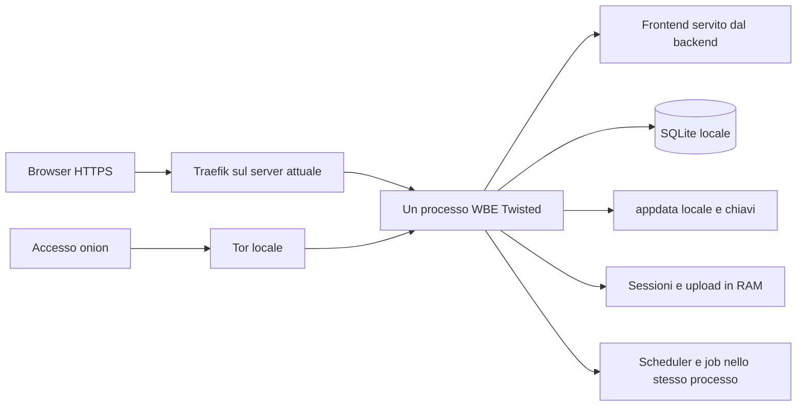
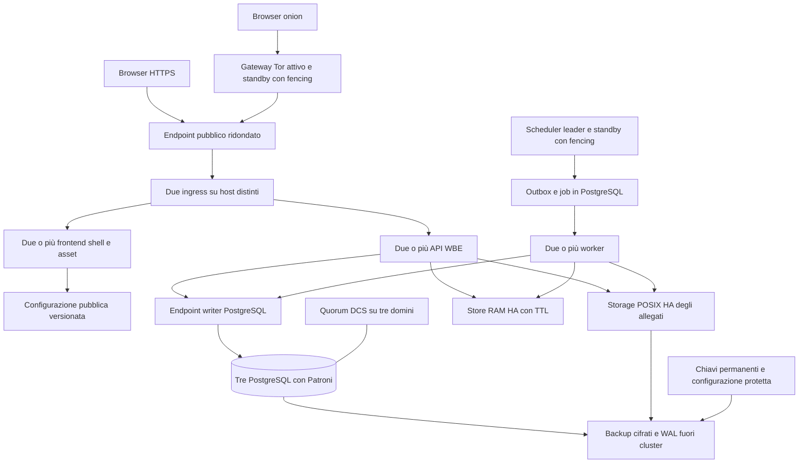

# Piano WBE per PostgreSQL e alta disponibilità

Data: 26 ottobre 2026. Stato: proposta architetturale da implementare e collaudare. Baseline repository `367b8635236bde61a289880d7002574b5ddff6ca`, GlobaLeaks nominale 5.0.99, schema WBE dichiarato dal codice 69 (la guida operativa documenta la migrazione; il DB live non è stato interrogato).

WBE può essere separato in frontend, backend e database PostgreSQL remoto, ma richiede modifiche applicative sostanziali. La prima release in produzione deve comprendere alta disponibilità dell'intera catena. Porting DB con un solo processo e separazione dei componenti sono tappe di sviluppo e staging, non release intermedie in produzione.

Vincoli dell'utente: VM o Docker; alta disponibilità dalla prima versione; fermo massimo un'ora. L'ora viene interpretata come limite della finestra di migrazione e limite massimo tollerabile di indisponibilità; per il recupero automatico da guasto singolo si propone un obiettivo più stretto di 5 minuti, da approvare e misurare. Numero di tenant, utenti concorrenti, volume allegati, infrastruttura disponibile e budget non sono ancora noti.

## Decisione proposta

Mantenere Python/Twisted, Angular e il protocollo crittografico applicativo, introducendo un adapter PostgreSQL, stato condiviso, upload recuperabili e ruoli separati per API e job. Distribuire servizi su VM in almeno tre domini di guasto indipendenti; Docker può confezionare web/API/worker, mentre PostgreSQL e il suo controllo HA possono essere gestiti su VM dedicate. Kubernetes non è necessario.

Il target iniziale usa PostgreSQL con tre nodi, failover coordinato e replica sincrona; almeno due istanze frontend e due API; scheduler attivo con standby e worker concorrenti; storage POSIX realmente HA per allegati; store volatile ridondato per sessioni e contesti temporanei. Il solo spostamento del file SQLite su rete non è un'alternativa.

L'HA copre il guasto di un componente o di un host, non rende innocua la perdita simultanea dell'intero sito. Un secondo sito e il relativo recupero disastri richiedono un progetto aggiuntivo. Se mancano tre domini indipendenti e storage ridondato, il requisito HA completo non è soddisfatto da tre VM sullo stesso host.

## Stato verificato della codebase e del progetto

| Area | Evidenza | Impatto |
|---|---|---|
| Produzione | `/opt/apps/wbe/node1`; app, timer monitor e Traefik risultavano attivi durante l'indagine | Analisi senza arresti o deploy |
| Sorgente di lavoro | `/opt/apps/wbe/repos/WhistleblowingEasy-upgrade`, checkout inizialmente pulito | Il checkout storico non è la base per il port |
| Versione | `backend/globaleaks/__init__.py:9` e `:12`, uguali nei file runtime verificati | 5.0.99, schema fork 69 |
| Stack | Guida `docs/WBE_OPERATIONS.md`; backend Python 3.12/Twisted/SQLAlchemy, frontend Angular 21 | Riutilizzare lo stack; nessuna riscrittura generale |
| Persistenza | `backend/globaleaks/orm.py:30,43,66`; `db/__init__.py:19,42,82` | URI da file, PRAGMA, authorizer, bootstrap e manutenzione SQLite |
| Sessioni | `backend/globaleaks/sessions.py:48,78,90,116` | RAM locale, contesto cifrato con chiave del client, revoca locale |
| Sicurezza distribuita | `backend/globaleaks/state.py:104,112,119,120` | PoW, TOTP, anti-replay, upload, rate limit da riprogettare per più processi |
| Frontend | `backend/globaleaks/handlers/staticfile.py:26`; `rest/api.py:407,647` | HTML genera lingua, direzione e nonce CSP per richiesta |
| File | `backend/globaleaks/db/__init__.py:140`; `jobs/delivery.py` | Pulizia all'avvio e delivery dipendono dal filesystem/stato locale |
| Personalizzazioni | `docs/WBE_OPERATIONS.md` | Slug canali, schema 69, branding, navigazione, IT/EN e isolamento tenant da preservare |

I riferimenti relativi in tabella sono interni al checkout indicato. I rapporti allegati dettagliano i punti e i file confrontati con runtime. Non è stata letta la base dati, né sono stati estratti allegati, credenziali o chiavi. Non sono stati eseguiti benchmark o test applicativi contro produzione. I conteggi 648 test backend e 73 browser nella guida sono risultati storici CI, non esecuzioni di questa analisi.

### GlobaLeaks upstream

L'ultima release restituita dalla fonte ufficiale è [5.0.99 del 26 luglio 2026](https://github.com/globaleaks/globaleaks-whistleblowing-software/releases/tag/v5.0.99). Il ramo stable osservato è [ac2c553 del 23 ottobre 2026](https://github.com/globaleaks/globaleaks-whistleblowing-software/commit/ac2c55372e3ef3bb74a1ad9befce021f45849b9f); ramo e release pubblicata non sono equivalenti. La storia locale contiene 72 commit dopo il tag 5.0.99 e modifica 255 file rispetto al tag: non sono necessariamente tutti cambiamenti esclusivi WBE.

Il [codice ORM upstream osservato](https://github.com/globaleaks/globaleaks-whistleblowing-software/blob/ac2c55372e3ef3bb74a1ad9befce021f45849b9f/backend/globaleaks/orm.py) resta SQLite-specifico. Nella [issue 1324](https://github.com/globaleaks/globaleaks-whistleblowing-software/issues/1324#issuecomment-760931387) il maintainer distingue possibilità teorica offerta da SQLAlchemy da supporto operativo e segnala lavoro e revisione del modello di sicurezza. Non è emerso un impegno di consegna PostgreSQL sul quale basare il progetto.

Conseguenza: WBE assume manutenzione di questo port e dell'HA. Gli audit e le proprietà del prodotto originale non certificano automaticamente la nuova architettura. Prevedere revisione di sicurezza prima del rilascio, un ramo di integrazione upstream, manifest di build e verifica periodica dei fix successivi alla baseline.

## Architettura attuale

Questa disposizione accoppia disponibilità del sito, scritture, allegati e stato temporaneo alla macchina e al processo. Il riavvio di un processo sostitutivo non è continuità trasparente delle sessioni.

## Architettura obiettivo della prima release

Le frecce mostrano dipendenze logiche; i servizi interni non sono pubblici. API e worker usano soltanto il writer per autorizzazioni, revoche e consistenza immediata. Le repliche DB inizialmente servono a disponibilità e recupero, non a distribuire tutte le SELECT.

| Ruolo | Distribuzione iniziale | Comportamento al guasto |
|---|---|---|
| Ingress | 2 istanze, endpoint VIP/LB con HA reale | L'endpoint passa al nodo sano; verificare rete, DNS e rinnovo TLS |
| Frontend | 2+ istanze con stessa build e asset versionati | Richieste successive su un'altra istanza |
| API | 2+ istanze senza stato autorevole locale | Retry sicuro e ripresa secondo protocollo applicativo |
| PostgreSQL | 3 nodi dati, Patroni e 3 membri DCS distribuiti | Promozione del candidato sicuro, isolamento del vecchio writer |
| Stato effimero | 1 primario e 2 repliche, 3 Sentinel se si sceglie Redis | Perdita stato ammessa solo con invalidazione sicura, mai ritorno a token revocati |
| Worker e scheduler | 2+ worker; un leader scheduler più standby | Claim scaduti recuperati, fencing del leader precedente |
| Allegati | Servizio POSIX HA con dati e controller ridondati | Ripresa accessi senza perdita dei file già confermati |
| Tor | Gateway attivo/standby, ownership unica identità onion | Subentro verificato e identità stabile; egress disponibile per ciascun ruolo |
| Backup | Deposito indipendente, cifrato e monitorato | Ripristino di DB, file, configurazione e chiavi coordinati |

Collocazione possibile: VM `edge-a/b`, `app-a/b`, `db-a/b/c`, più servizio storage HA e deposito backup. DCS può coesistere sulle tre VM DB; store volatile e Tor richiedono distribuzione su tre/due domini rispettivamente e limiti di risorse. Sono ruoli di riferimento, non un numero minimo certificato di VM: l'accorpamento dipende da risorse e domini fisici. Ogni componente deve restare operativo con un host perso. Due ingress sullo stesso hypervisor o un NFS su una singola VM lasciano punti singoli di guasto.

Per VM usare provisioning riproducibile e systemd; per Docker immagini immutabili e supervisione host. Compose su una sola macchina non fornisce HA tra host. Il registry non deve essere necessario per riavviare immagini già distribuite. Evitare dipendenze runtime dal server CI.

### PostgreSQL e disponibilità dei dati

Adottare una major PostgreSQL supportata e congelata dopo il PoC (18 è la baseline candidata nella documentazione consultata), con driver compatibile verificato sul runtime scelto. Il lockfile noble contiene SQLAlchemy 1.4.50; altri lockfile distribuzione hanno versioni diverse: il manifest deve fissare quale combinazione viene effettivamente usata. Non cumulare automaticamente upgrade ORM maggiore e porting DB.

Usare rete privata, TLS con verifica identità `verify-full`, credenziali applicative senza DDL e credenziale separata del migratore. Pool persistente per processo, timeout di connessione/query/lock e budget connessioni comune ad API e worker. L'engine attuale creato per sessione va sostituito con lifecycle controllato; un pooler esterno è opzionale e va verificato con advisory lock e semantica transazionale. Fonte: [TLS PostgreSQL](https://www.postgresql.org/docs/current/libpq-ssl.html).

Proposta Patroni: modalità sincrona strict, nessuna promozione di replica che possa perdere commit confermati, DCS a tre voti e fencing/watchdog verificato sulla virtualizzazione scelta. Quando manca un candidato sincrono sicuro si bloccano le scritture. Tre nodi dati permettono di conservare ridondanza dopo un guasto singolo; non autorizzano promozioni arbitrarie in guasti multipli. Fonti: [replicazione Patroni](https://patroni.readthedocs.io/en/latest/replication_modes.html), [fencing](https://patroni.readthedocs.io/en/latest/watchdog.html).

Obiettivi proposti: RPO zero per segnalazioni dichiarate acquisite durante un guasto singolo, subordinato a commit DB sincrono e durabilità degli allegati; RTO entro 5 minuti nei test di failover singolo. RPO indica quante scritture confermate si possono perdere; RTO quanto tempo serve a ripristinare il servizio. Non sono garanzie già ottenute. Indisponibilità di quorum prevale sulla possibilità di accettare scritture divergenti.

### Frontend indipendente e routing

Separare asset JS/CSS/font versionati e una piccola shell HTML replicabile. La shell deve preservare generazione nonce CSP, lingua/RTL e header di sicurezza; può derivare queste informazioni da configurazione pubblica versionata/API interna. Nel PoC servire prima gli asset separatamente lasciando temporaneamente la shell al backend; nella release target shell e asset devono avere un ruolo distribuibile indipendentemente.

Mantenere un'unica origine pubblica: `/api` alle API, asset al servizio web, documenti HTML alla shell. Preservare `/viewer`, route tecniche, tenant e alias canali, query e link legacy. DPoP richiede che normalizzazione di metodo/percorso resti coerente attraverso il proxy. Header forwarded accettati solo da proxy fidati. HTML, API, ricevute, download e allegati privati non devono entrare in cache condivise. Cache lunga soltanto per asset realmente immutabili, con vecchi chunk conservati per sessioni aperte e deploy/rollback.

### Sessioni e controlli di sicurezza distribuiti

Definire interfacce per sessioni, token, cache configurazione, rate limit e upload. Conservare la cifratura del contesto di sessione legata al segreto detenuto dal client e il binding DPoP. Serializzare dati espliciti con versione; non trasferire oggetti Python, cipher o timer reactor tra nodi.

Candidato per stato effimero: Redis ridondato, TLS/ACL, TTL e limiti di memoria; persistenza AOF/RDB disabilitata per segreti temporanei, nessun dump/core/swap non protetto. Password reset e chiavi temporanee richiedono la stessa disciplina dei percorsi tmpfs attuali. La replica Redis è asincrona: Sentinel da solo non garantisce che una revoca o un consumo token sopravvivano al failover. Fonte: [limiti e HA Sentinel](https://redis.io/docs/latest/operate/oss_and_stack/management/sentinel/).

Per la prima release, rendere autorevoli in PostgreSQL le generazioni di autorizzazione/revoca e i consumi di sicurezza che non possono essere dimenticati: identificatori hash, scadenze, unicità e aggiornamenti atomici, senza bearer, password o chiavi in chiaro. Il protocollo deve controllare tali generazioni a ogni uso rilevante, senza affidarsi a una notifica cache. Per DPoP/TOTP/PoW definire esattamente namespace e finestra di validità, registrazione del consumo e comportamento al retry. In caso di failover incerto dello store RAM, bloccare l'uso del vecchio stato e ruotare una generazione autorevole prima di riaprire; tutti i nodi devono riconoscerla. Nessun fallback a controlli solo locali.

Questo ledger introduce metadati persistenti che oggi possono essere solo volatili: minimizzazione, TTL logico, retention di backup/WAL e modello di minaccia sono un gate progettuale, non un dettaglio da rimandare. Se la conservazione non è accettabile, occorre un protocollo alternativo con invalidazione dimostrabile e revisione dedicata prima del rilascio. Il log-out forzato dopo perdita dello store può essere accettabile; il ritorno di una sessione revocata non lo è.

Cache tenant/configurazione: versioni autorevoli e invalidazione con recupero degli eventi persi. Permessi e revoche non devono usare cache stantia. Rate limit e lock download devono mantenere un limite globale e limiti per nodo, senza accumulare indirizzi o dati personali non necessari.

### Upload e storage

L'attuale contesto di cifratura upload vive nel processo: montare una directory comune non basta. Introdurre un protocollo upload con ID opaco, proprietario e tenant, manifest di chunk, offset/digest, claim con scadenza, finalizzazione idempotente e stati `pending`, `ready`, `failed`. Il dettaglio crittografico richiede PoC: preservare il formato esistente o introdurre una versione esplicita con lettura retrocompatibile; non serializzare lo stato interno del cipher e non riutilizzare nonce dopo retry.

La prima release conserva accesso POSIX tramite un servizio storage HA, con semantica rename/fsync/locking dimostrata, cifratura e controllo accessi. Un object storage è evoluzione possibile, ma richiederebbe adapter e nuovo protocollo per download, export, pulizia e backup: non lo si aggiunge implicitamente al primo port.

Sequenza proposta: rendere durevole il file cifrato e il manifest, poi committare il riferimento DB; confermare acquisizione al client solo quando entrambi sono sicuri. Un crash intermedio lascia oggetti orfani recuperabili, non record `ready` con file assenti. Pulizia tramite job coordinato con lease e periodo di grazia, mai scansione distruttiva in avvio di ogni API. Riconciliare stati incompleti, quote e hash prima di eliminare dati. La replica storage deve assicurare la durabilità dichiarata prima dell'ack applicativo.

Un upload non ancora confermato può richiedere ripresa o reinvio dopo un guasto; deve essere rilevabile e non tradursi in una segnalazione apparentemente acquisita. La codebase contiene anche percorsi plaintext: prima della migrazione inventariare le impostazioni effettive con l'operatore, senza cambiare silenziosamente la politica crittografica.

### Job e processi di servizio

Introdurre ruoli espliciti `api`, `worker`, `scheduler`; API senza migrazioni, pulizie o scheduler automatici al boot. Il migratore è un comando separato, eseguito una sola volta con lock globale; ogni API controlla compatibilità schema e readiness.

Schedulazione con un leader e standby, lease con scadenza e fencing per impedire al leader isolato di continuare. Job durable in PostgreSQL con claim transazionale, tentativi, scadenza, backoff e idempotenza. Outbox nella stessa transazione della modifica applicativa per evitare notifiche perse prima del commit. File delivery e notifiche hanno chiavi di deduplicazione; SMTP non offre una garanzia assoluta exactly-once, quindi documentare la possibile mail duplicata dopo esito ambiguo e non duplicare la consegna logica del report.

Separare Tor dal ciclo di vita API; governare identità onion e rinnovi TLS con ownership unica. Collaudare il subentro onion e la pubblicazione del servizio con la specifica versione Tor scelta: duplicare la chiave su due daemon non costituisce da solo una soluzione HA. Verificare egress Tor/SOCKS anche per worker e notifiche, evitando che la separazione trasformi involontariamente traffico anonimo in traffico diretto.

## Porting del database

| Intervento | Contratto da ottenere |
|---|---|
| Adapter dialect e configurazione | URI esterna protetta, PRAGMA solo SQLite, driver PostgreSQL, credenziali non loggate |
| Engine e transazioni | Pool per processo, rollback corretto, retry limitati a errori recuperabili; niente replay cieco di effetti esterni |
| Modelli e schema | Tipi, timestamp, JSON, booleani, binary, default, indici, vincoli e confronti coerenti tra dialect |
| Concorrenza | Incrementi atomici e lock dove necessari, vincoli unici e gestione conflitti; evitare read-modify-write perso |
| Bootstrap | Schema creato dal migratore, non da ciascuna API; niente ricerca obbligatoria di un file DB locale |
| Migrazioni | Baseline PostgreSQL dallo schema WBE 69 e migrazioni successive versionate; nessuna copia old.db/new.db per PostgreSQL |
| Importatore | SQLite in sola lettura, mapping esplicito, ordine FK, ID/ciphertext preservati e verifica completa |
| Operazioni | Backup/restore remoti, readiness, monitoraggio, upgrade e failover consapevoli del cluster |

I tipi custom correnti in `backend/globaleaks/models/properties.py:17,33` serializzano JSON come testo ed enum come interi: conservarne inizialmente il contratto. Non convertire automaticamente ogni stringa JSON in JSONB o cambiare ogni data in timestamptz: verificare semantica e serializzazione usate dal codice. Conservare identità tenant, ricevute/hash, configurazioni, relazioni, byte crittografici e versioni. Validare il significato di NULL, stringa vuota, case sensitivity e vincoli: SQLite può aver ammesso dati che PostgreSQL rifiuta.

Un esempio concreto è `backend/globaleaks/handlers/whistleblower/submission.py:138`: legge e incrementa il contatore in Python; le righe 144–152 fanno check-then-insert dello schema archiviato. Servono incremento/lock e gestione del conflitto atomici. Per concorrenza testare contatori di segnalazioni, unicità slug, concessioni/revoche, selezione di job, invii simultanei e cancellazione file. Le serializzazioni oggi indirettamente fornite dal writer SQLite non si trasferiscono automaticamente a READ COMMITTED PostgreSQL.

Il tool di import deve poter ripartire in modo deterministico su un target vuoto isolato, produrre conteggi e digest canonici per tabella senza dati sensibili, controllare PK/FK e sequenze, verificare file e dimostrare lettura/decrittazione con account sintetici. Non basta che tutte le INSERT riescano. L'import non deve riattivare vecchie notifiche o rieseguire migrazioni di dati già applicate.

## Migrazione entro un'ora

### Preparazione senza fermo

1. Riconciliare manifest codice/runtime, schema di origine e configurazione; congelare la release destinazione. Verificare che tutte le personalizzazioni e i fix rilevanti siano coperti.
2. Allestire ambiente HA parallelo, indirizzi stabili, certificati, ACL e servizi monitorati. Lasciare traffico reale e mail disabilitati sul target fino al passaggio.
3. Provare import e restore prima su dati sintetici, poi su una copia autorizzata e protetta rappresentativa di volume e formato. Nessun dato reale nei repository o in `/tmp`.
4. Preparare copia iniziale protetta degli allegati permanenti; al cutover effettuare riconciliazione finale di modifiche e cancellazioni con manifest. La copia a caldo non è ancora uno snapshot coerente.
5. Eseguire almeno due prove complete cronometrate, incluso ritorno all'origine; misurare anche tempo di backup coerente, delta file e verifica, non solo caricamento SQL.
6. Precaricare immagini/build e verificare nuove route prima della finestra. Preferire cambio backend nel bilanciatore a un cambio DNS non prevedibile.

### Budget indicativo della finestra

| Minuti dall'inizio | Operazione | Condizione |
|---|---|---|
| 0–5 | Manutenzione su tutti gli ingress, stop monitor, drenaggio e stop writer/job legacy | Nessuna nuova scrittura SQLite; upload incompleti identificati |
| 5–10 | Snapshot/backup coerente e sincronizzazione finale file/chiavi | Copia verificata, baseline preservata |
| 10–25 | Import nel target e verifiche integrità automatizzate | Conteggi/digest/relazioni/file coerenti |
| 25–35 | Avvio ruoli HA e smoke test isolati, traffico utenti ancora chiuso | Login, ricevuta, lettura file, slug, permessi e cluster sani |
| Entro 35 | Decisione passaggio o abbandono | Tutti i gate verdi, altrimenti rollback |
| 35–45 | Cambio route, apertura scritture, osservazione immediata | Un solo sistema autorevole per le nuove scritture |
| 45–60 | Margine operativo e verifica servizio | Intera interruzione inferiore a 60 minuti |

Questo budget è una condizione di accettazione, non una previsione basata su volume noto. La soglia di abbandono reale è `60 minuti - tempo rollback provato - margine`. L'esempio minuto 35 presuppone rollback entro 15 minuti e margine di 10. Se le prove non rientrano, non si programma il cutover: ottimizzare copia/import o progettare una migrazione incrementale dedicata. Non introdurre dual-write improvvisato tra SQLite e PostgreSQL.

### Rollback e punto di non ritorno semplice

Prima di aprire le scritture utenti su PostgreSQL, si può tornare al vecchio sistema congelato, alla configurazione e allo storage preservati, riattivando correttamente app e monitor. Target isolato, nessun job con effetti esterni; smoke test con dati sintetici separati. Non esporre contemporaneamente i due writer.

Dopo la prima nuova scrittura confermata su PostgreSQL, il vecchio SQLite non è più aggiornato. Ripristinarlo perderebbe segnalazioni. Il recupero normale è failover/fix sul nuovo cluster oppure rollback del binario compatibile con il medesimo schema e DB. Un ritorno a SQLite richiede esportazione inversa e riconciliazione progettate e collaudate separatamente; non è promesso entro l'ora. Per questo l'apertura delle scritture avviene solo dopo le verifiche bloccanti e con target HA già operativo.

## Backup e riservatezza

Prevedere base backup PostgreSQL e archiviazione WAL per recupero puntuale, più backup di allegati, chiavi permanenti e configurazioni. `pg_dump` è utile come esportazione logica, non sostituisce base backup e WAL per PITR. Fonte: [backup e PITR PostgreSQL](https://www.postgresql.org/docs/current/continuous-archiving.html).

Ogni recovery set deve indicare revisioni applicative, schema, punto DB e manifest/versioni file coerenti. Per l'avvio del progetto usare checkpoint coordinati con breve quiescenza per certificare un insieme completo; per recupero continuo definire storia file e cancellazioni coerente con l'intera finestra WAL. Provare restore includendo un allegato creato e uno cancellato attorno al punto di recupero. Il PITR del DB da solo non ricrea file persi.

PostgreSQL MVCC, WAL, repliche e backup non riproducono `secure_delete` SQLite: VACUUM riutilizza spazio e non è una garanzia di cancellazione forense. Fonti: [VACUUM](https://www.postgresql.org/docs/current/sql-vacuum.html), [archiviazione WAL](https://www.postgresql.org/docs/current/continuous-archiving.html). Definire retention minima necessaria, cifratura di tutte le copie e distruzione delle chiavi dove applicabile; documentare l'effetto delle copie immutabili e dei backup sulle cancellazioni. La cifratura disco non sostituisce quella applicativa e non elimina l'accesso del server ai dati che il software conserva in chiaro.

Non registrare session token, ricevute, contenuto segnalazioni, chiavi o query param sensibili in access log, tracing o error reporting. Metriche aggregate per capacità e guasti, con accessi operativi limitati. Backup separati dal cluster, controllati per freschezza e recuperabilità; nessuna dipendenza da un'unica credenziale o chiave disponibile solo sul nodo guasto.

## Piano di lavoro e responsabilità

Tutte le fasi fino al gate finale si svolgono in sviluppo/staging. La prima apertura produttiva include l'intero target HA.

| Fase | Responsabile funzionale | Output e gate | Stima preliminare in settimane persona |
|---|---|---|---|
| 0 Baseline e PoC | Lead backend e infrastruttura | Inventario, metriche, threat model, prova driver/import e scelta storage | 1–2 |
| 1 Port PostgreSQL | Backend/data engineer | Adapter, schema, migrazioni, importatore, concorrenza e CI | 3–5 |
| 2 Stato e upload | Backend con revisore sicurezza | Sessioni/token globali, protocollo upload, revoche e recovery | 4–7 |
| 3 Frontend e ruoli | Frontend/backend | Shell indipendente, asset, routing, worker/outbox/fencing | 2–4 |
| 4 Infrastruttura HA | Infrastruttura/DBA | DB, ingresso, RAM, file, Tor, backup e provisioning | 3–5 |
| 5 Qualifica e cutover | QA, DBA e lead | Test guasti/carico, revisione sicurezza, due prove entro budget | 2–4 |

Ordine di grandezza totale 15–27 settimane persona, non preventivo. Con 2–3 persone e attività infrastrutturali in parallelo, un primo intervallo di calendario da verificare è 8–14 settimane; protocollo crittografico upload, disponibilità storage e prove di sicurezza possono allungarlo. Ristimare dopo fase 0. Non promettere una modifica di pochi giorni: il DB è solo parte dell'intervento.

La spesa ricorrente dipende soprattutto da domini di guasto reali, storage HA, backup fuori cluster, monitoraggio e presidio operativo. Quantificare dopo inventario infrastruttura; un prezzo mensile senza provider, dischi e capacità sarebbe inventato.

## Verifiche bloccanti prima del rilascio

| Prova | Criterio |
|---|---|
| Import | Conteggi e digest coerenti, nessun FK orfano, ID e byte crittografici preservati |
| Regressione | Suite backend/browser/proxy esistente più test PostgreSQL; personalizzazioni WBE preservate |
| Isolamento | Nessun accesso cross-tenant; slug non trasformato in confine autorizzativo |
| Stato su due API | Revoca su A immediata su B; replay DPoP/TOTP rifiutato; rate limit globale |
| Guasto store RAM | Nessuna resurrezione sessioni/token consumati; invalidazione sicura e recupero documentato |
| Upload | Crash tra chunk e finalizzazione, retry duplicato, worker perso; nessun file confermato perso |
| Concorrenza | Contatori, slug, claim e revoche corretti con richieste simultanee |
| DB e quorum | Stop primary, stop standby, partizione rete, leader sospeso; nessun doppio writer |
| Storage e ingress | Perdita controller/host/ingress, mount bloccato; nessuna falsa readiness o perdita dati |
| Scheduler | Kill/partizione leader, job lunghi; niente effetti logici duplicati o cancellazioni concorrenti |
| Frontend | CSP/nonce coerenti, IT/EN/RTL, viewer, link legacy, nuove route e vecchi chunk |
| Tor | Subentro gateway, identità onion e policy egress preservate |
| Recupero | Restore completo DB/file/chiavi con tempi misurati; rollback prima delle nuove scritture |
| Cutover | Due prove sotto 60 minuti con margine e soglia di abbandono verificata |

Per capacità raccogliere picco richieste/sec, sessioni attive, byte upload/sec, dimensione massima file, crescita giornaliera, tempi export, ritardo job e latenza storage. Prova al picco atteso e ad almeno il doppio come scenario iniziale da calibrare, anche con un nodo perso. Scalare API su latenza/CPU/attese e worker su coda/tempi job; limitare il totale connessioni DB e il carico crittografico. Nessun numero di utenti supportati è deducibile dalla sola lettura del codice.

Liveness verifica il processo; readiness verifica schema e dipendenze necessarie per servire richieste in sicurezza. Allarmi per failover, lag, quorum, WAL/backup, spazio, pool saturo, code, stato upload, errori auth e storage. Non usare il vecchio monitor per riaccendere il nodo legacy dopo il cutover.

## Manutenzione e decisioni residue

Registrare baseline upstream e WBE separatamente; mantenere test SQLite per compatibilità/import e PostgreSQL come target. Separare patch del dialect da personalizzazioni UI per ridurre conflitti. Usare migrazioni compatibili tra versioni successive quando si vogliono deploy progressivi; modifiche incompatibili richiedono finestra coordinata. Gli aggiornamenti automatici upstream non devono sovrascrivere il fork. Preservare attribuzioni e sorgente corrispondente alla versione modificata secondo i termini del progetto.

Prima di impegnare tempi e risorse, servono inventario di host/hypervisor/rete/storage disponibili, volumi e carico aggregati, scelta del servizio POSIX HA, budget e conferma degli obiettivi RPO/RTO proposti. Restano da chiudere nel PoC il protocollo upload recuperabile e l'accettabilità dei metadati di sicurezza persistenti. Sono decisioni tecniche con test di uscita, non motivi per interrompere la preparazione di adapter, inventario e ambiente isolato.

## Rapporti di supporto

I rapporti [database](WBE_POSTGRESQL_RESEARCH/database.md), [scalabilità](WBE_POSTGRESQL_RESEARCH/scaling.md) e [upstream](WBE_POSTGRESQL_RESEARCH/upstream.md) contengono le evidenze raccolte dai tre agenti. Questa strategia prevale sulle alternative esplorative: HA completa dalla prima release, fasi intermedie solo in staging, storage POSIX HA iniziale e nessun rollback a SQLite obsoleto dopo nuove scritture. L'indagine è architetturale e documentale; implementazione, certificazione di sicurezza e prove di prestazione restano attività pianificate.

Consolidamento: accettate le evidenze dei tre ambiti e verificate direttamente ORM, startup/cleanup, sessioni, stato globale, shell HTML, versione e guida operativa. Scartata come release produttiva la proposta esplorativa di partire con singolo backend; mantenuta soltanto come tappa di laboratorio. Le stime dei workstream condividono attività di integrazione/test e non sono sommate; la stima complessiva è preliminare e va rifatta dopo il PoC. Nessun codice applicativo, servizio, database o configurazione operativa modificato.

## Avanzamento implementativo

La separazione dei layer e il port PostgreSQL per il laboratorio di Fase 1 sono descritti nel [rapporto di implementazione](../plans/WBE_PHASE1_IMPLEMENTATION.md) e nel [runbook](../plans/WBE_PHASE1_RUNBOOK.md). Il laboratorio non realizza ancora il disegno HA produttivo qui definito.
