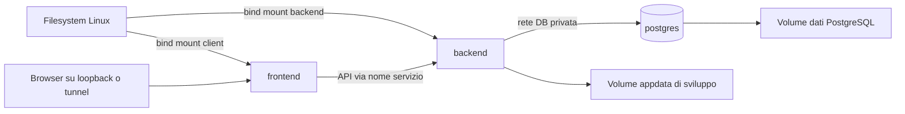

# Piano implementativo WBE Fase 1

Data del piano: 26 ottobre 2026. Piano attuato nel worktree `/opt/apps/wbe-refact`, branch `feature/phase1-layers-postgresql`. La sezione «Stato iniziale» conserva la fotografia precedente all’implementazione. Per stato verificato e limiti vedere [rapporto di implementazione](WBE_PHASE1_IMPLEMENTATION.md) e [runbook](WBE_PHASE1_RUNBOOK.md).

## Obiettivo e perimetro

Realizzare in `/opt/apps/wbe-refact` un ambiente di sviluppo WBE con tre layer separati: frontend, backend e PostgreSQL. Frontend e backend leggono il codice dal filesystem Linux tramite bind mount; le loro immagini contengono runtime e dipendenze, non una copia autoconsistente dell'applicazione. PostgreSQL usa un'immagine standard e storage persistente separato.

La Fase 1 comprende il port effettivo della persistenza, l'importatore SQLite verso PostgreSQL e il collaudo della separazione dei layer. Non basta avviare tre container se il backend continua a scrivere SQLite. L'ambiente usa dati sintetici; una prova su copia reale richiederà un ambiente protetto e una procedura dedicata.

Il precedente requisito di HA completa per il primo rilascio produttivo rimane valido. Questa fase abilita sviluppo e staging con un solo backend e un solo PostgreSQL. Il risultato non è ancora un cluster HA e non sostituisce la produzione. L'ora massima di fermo resta un vincolo del futuro cutover, da verificare con prove cronometrate.

Disegno generale: [WBE PostgreSQL e HA](../design/WBE_POSTGRESQL_HA_PLAN.md).

## Stato iniziale verificato

| Voce | Stato |
|---|---|
| Sorgente base | `/opt/apps/wbe/repos/WhistleblowingEasy-upgrade`, commit `367b8635236bde61a289880d7002574b5ddff6ca` |
| Branch dedicato | `feature/phase1-layers-postgresql` creato sul commit base |
| Checkout attuale | Rimane sul branch `upgrade/globaleaks-5.0.99` |
| Directory nuova | Non ancora creata: permessi POSIX su `/opt/apps`; `sudo -n` richiede password |
| Produzione WBE | `/opt/apps/wbe/node1`, da mantenere indipendente |
| Baseline applicativa | Codice 5.0.99, schema dichiarato 69; DB live non interrogato |
| Stack di riferimento | Docker Compose project `notarius-internal`, FE, server, postgres |
| Compose host | `docker compose` non disponibile; `/usr/bin/docker-compose` è 1.29.2 |
| Compose di Notarius | `/opt/apps/notarius/bin/docker-compose` è 5.3.1 |

Notarius espone FE su loopback 18080 e BE su loopback 18081; PostgreSQL non pubblica porte host. FE non ha bind mount, BE monta directory dati e utilizza un'immagine applicativa; il codice non è montato dall'host nei container osservati. Si riprende il modello a tre servizi e reti separate, adattando WBE ai bind mount richiesti. Non si riutilizzano dati, credenziali, rete privata o database di Notarius.

Nessuna necessità di pgvector per WBE è emersa: scegliere PostgreSQL standard. Non modificare lo stack Notarius, il proxy globale o i servizi WBE correnti per preparare questo ambiente.

## Struttura prevista

```text
/opt/apps/wbe-refact/                   checkout Git dedicato
  backend/                            sorgente Python esistente
  client/                             sorgente Angular esistente
  deploy/dev/
    compose.yml                       frontend, backend, postgres
    Dockerfile.backend-runtime        runtime e dipendenze senza COPY del codice
    Dockerfile.frontend-runtime       runtime e dipendenze senza COPY del codice
    backend-entrypoint.sh
    frontend-entrypoint.sh
    frontend-server/                  shell HTML, asset e proxy stessa origine
    env.example                       configurazioni senza segreti
  scripts/dev/
    bootstrap.sh                      predisposizione dati e dipendenze
    compose.sh                        wrapper Compose con versione verificata
    build-client.sh
    migrate.sh
    import-sqlite.sh
    smoke.sh
  docs/plans/
    WBE_PHASE1_LAYERS_POSTGRESQL.md
  docs/design/                        disegno generale e rapporti
  .local/                             esclusa da Git
    appdata/                          dati applicativi di sviluppo
    postgres/                         dati DB persistenti, permessi dedicati
    secrets/                          credenziali generate localmente
    imports/                          solo fixture o copie autorizzate protette
    backups/                          backup locali di sviluppo
```

Conservare `backend/` e `client/` evita rinominare l'intero progetto. La separazione dei layer è anzitutto nei processi, nelle dipendenze e nei volumi. La directory runtime `.local` va esclusa anche da ogni contesto build e archivio dei sorgenti.

## Topologia di sviluppo



| Servizio | Sorgente e dati | Accesso |
|---|---|---|
| frontend | `client/` montato; build Angular generata e servita dal filesystem; dipendenze container isolate | Porta candidata `127.0.0.1:18090`, da verificare prima dell'avvio |
| backend | `backend/` montato; appdata separata; tmpfs per materiali effimeri secondo semantica attuale | Porta interna al progetto; eventuale debug loopback solo con override |
| postgres | Immagine standard fissata; volume persistente; segreto via file | Porta 5432 soltanto nella rete DB |

Rete `web`: FE e BE. Rete `database`: BE e PostgreSQL, privata. Il FE non accede al DB. Per il browser API e documenti restano sulla medesima origine: il frontend inoltra `/api` al backend tramite DNS Compose, senza URL container nel client.

Le immagini runtime possono essere costruite da Dockerfile per fissare dipendenze OS/Python/Node. Questo non contraddice la richiesta: non incorporano il sorgente applicativo. Dipendenze installate da lockfile in un passo esplicito, non a ogni restart. Backend con restart controllato dopo modifica Python; frontend ricompilabile tramite container di tooling. Hot reload è una comodità successiva, non un requisito per il port.

Non montare virtualenv o node_modules della produzione. Utilizzare volumi dipendenze dedicati o dipendenze nell'immagine runtime, con gestione esplicita del bind mount che potrebbe nasconderle. UID/GID e directory scrivibili definiti per evitare sorgenti host creati come root.

## Attività e criteri di completamento

### P0 Preparare checkout e strumenti

1. Creare la directory con un operatore autorizzato. Il tentativo non privilegiato è fallito; il branch è già presente, quindi non ripetere `git worktree add -b`.
2. Collegare il nuovo checkout al branch esistente. Copiare nel worktree design e piano, che nel checkout originale sono ancora file non tracciati: Git non li trasferisce automaticamente.
3. Predisporre `.gitignore` e `.dockerignore` per `.local`, dipendenze e output.
4. Installare o predisporre Compose moderno per WBE, con provenienza/versione verificata. Evitare dipendenza permanente dal binario collocato nella directory Notarius; non aggiornare Docker globale come effetto collaterale.
5. Definire project name `wbe-refact`, porte libere, reti, limiti risorse e segreti distinti.

Comandi per l'operatore che dispone di sudo, da eseguire soltanto se il percorso è ancora assente:

```sh
sudo install -d -o ibladmin -g iblapps -m 2770 /opt/apps/wbe-refact
git -C /opt/apps/wbe/repos/WhistleblowingEasy-upgrade worktree add \
  /opt/apps/wbe-refact feature/phase1-layers-postgresql
```

Gate: checkout nuovo sul branch corretto, produzione invariata, Compose valido e nessuna collisione di nomi/porte. Nessun commit o push è stato effettuato durante la pianificazione.

### P1 Creare lo scheletro dei tre layer

Preparare compose, immagini runtime, entrypoint e wrapper. PostgreSQL persistente con healthcheck; backend e frontend avviati da codice montato. Il comando migratore usa lo stesso runtime del BE come servizio one-shot, non un quarto layer permanente.

Congelare una combinazione Python/SQLAlchemy/driver PostgreSQL coerente con la distribuzione scelta. Punto di partenza Python 3.12; i lockfile backend differiscono tra distribuzioni, perciò non assumere che tutti usino la stessa versione ORM. Node deve rispettare gli engines delle dipendenze Angular bloccate. PostgreSQL 18 è candidato da validare nel PoC, non un requisito per aggiornare componenti estranei.

Gate: container riconoscibili come project `wbe-refact`; dati persistenti dopo ricreazione; sorgente modificabile sull'host senza ricostruire immagine applicativa; DB raggiungibile solo dal BE/migratore. Nessuna dichiarazione di successo del port finché P2 non è completa.

### P2 Implementare PostgreSQL nel backend

Intervenire su:

- `backend/globaleaks/orm.py`: configurazione dialect, engine per processo, pool, timeout e driver; PRAGMA/authorizer soltanto sul percorso SQLite.
- `settings.py` e `state.py`: DSN/segreto da configurazione esterna, accessi iniziali al DB, errore esplicito se il DB remoto manca; nessun fallback silenzioso a SQLite o installazione nuova.
- `db/__init__.py` e `backend.py`: separare creazione/migrazione schema dall'avvio; controllare versione e readiness. Niente VACUUM PostgreSQL automatico al boot.
- `db/migration.py`: conservare percorso legacy SQLite e aggiungere baseline PostgreSQL versionata per schema WBE 69, senza copiare/rinominare file .db sul percorso PostgreSQL.
- `models/properties.py` e modelli: conservare inizialmente JSON come testo ed enum come interi; verificare bool, date, FK differibili/composite, ID autoincrementali e sequenze.
- Operazioni concorrenti: correggere incremento del contatore in `handlers/whistleblower/submission.py:138` e check-then-insert dello schema archiviato; esaminare pattern analoghi.
- Retry: classificare errori del driver, rollback e budget; nessun retry cieco dopo commit ambiguo o effetti esterni.

Credenziali runtime senza privilegi schema/DDL, credenziali migratore separate. Nessun DSN con password nei log. La configurazione deve poter puntare a PostgreSQL su un'altra VM tramite TLS verificato; la rete Compose privata è la prima destinazione di test.

Gate: nuova installazione su PostgreSQL, creazione tenant, login, segnalazione e riavvio con dati persistenti. Verifica negativa: DB spento produce errore/readiness negativa e non genera un file SQLite alternativo. Eseguire suite backend con PostgreSQL reale, non solo mock o compilazione DDL.

### P3 Separare il frontend senza perdere i contratti web

L'attuale HTML iniziale non è statico: `handlers/staticfile.py` sostituisce lingua, direzione e nonce CSP; `rest/api.py` costruisce gli header di sicurezza. Un semplice nginx che serve il build grezzo non è equivalente.

Primo incremento: FE serve asset compilati e inoltra temporaneamente documenti dinamici e API al BE. Questa è una compatibilità transitoria, non il gate finale della separazione.

Completamento: introdurre nel runtime FE un piccolo server della shell HTML e del proxy, con template e build montati. Definire prima il contratto con il BE per le sole informazioni pubbliche necessarie a tenant e lingua. Il FE non deve replicare autorizzazioni o leggere il DB. Non scegliere il motore della shell prima di aver verificato con uno spike la parità di header, nonce e routing; la scelta tra servizio minimale e template proxy viene registrata in un ADR.

Preservare unica origine, `/api`, `/viewer`, route tenant, alias canali, link hash legacy, traduzioni e asset. Non modificare involontariamente normalizzazione DPoP, header sessione o fiducia nei forwarded header. HTML e risposte private non vengono messi in cache condivise; cache lunga soltanto per asset immutabili. Conservare i chunk necessari alle sessioni aperte.

Gate finale: FE serve documenti e asset senza montare sorgente backend, BE serve API senza dipendere dal build client; funzioni WBE, CSP, IT/EN e navigazione restano corrette. Correggere avviso di fork/link sorgente nella fase di confezionamento rilascio, preservando attribuzioni già presenti.

### P4 Realizzare importatore e verifica dati

Tool separato, versionato, senza accesso implicito al nodo live. Input: snapshot SQLite coerente schema 69, manifest file e configurazione necessaria. Output: DB PostgreSQL isolato e manifest di verifica.

Richiedere target vuoto; modalità dry-run per controlli; mapping esplicito di tipi e ordine delle FK. Conservare ID, tenant, hash ricevute, byte crittografici, relazioni e configurazione, poi riallineare sequenze. Nessuna rigenerazione delle chiavi o conversione crittografica durante l'import. Report di conteggi/digest senza contenuti sensibili; esito non zero in caso di incoerenza. Ripetibilità su un nuovo target vuoto, senza lasciare un import parziale dichiarato pronto.

Gli allegati restano file: copiarli in appdata di sviluppo separata, verificando associazione DB/file, hash e diritti. Non copiare in blocco appdata di produzione senza procedura, né inviare notifiche vere dalle prove. Attivare sink mail o disabilitazione esplicita delivery esterna per il laboratorio.

Gate: import di fixture rappresentative con test lettura, ricevuta, commenti, allegati e decrittazione; uguaglianza conteggi e valori critici; nessuna perdita silenziosa, FK orfana o email reale. Cronometrare import e validazione.

### P5 Collaudare e documentare l'ambiente

1. Smoke completo attraverso il FE: inizializzazione, admin, canale, invio, accesso con ricevuta, allegato e gestione destinatario su dati sintetici.
2. Suite backend SQLite per regressioni mantenute e PostgreSQL per il target; adattare fixture oggi dipendenti da copie SQLite.
3. Test concorrenza di contatori/unicità e transazioni anche con un solo BE: il threadpool esegue più richieste contemporaneamente.
4. Test frontend/proxy esistenti, CSP/nonce, slug, viewer, IT/EN e autorizzazioni tenant. Il solo HTTP 200 non prova che una route API restituisca JSON corretto.
5. Restart BE/FE/DB e recupero pool; stop DB e readiness negativa; nessun dato perso sui commit confermati durante normale restart.
6. Backup e ripristino coordinati di PostgreSQL, file e chiavi in un nuovo ambiente di test. Il vecchio tar di appdata non include il PostgreSQL remoto.
7. Verifica bind mount: modifiche al codice host applicabili senza incorporarlo nell'immagine; rebuild dipendenze soltanto quando cambia lockfile/runtime.
8. Runbook con comandi bootstrap/build/up/down/migrate/import/test/backup/restore, e avviso che `down -v` elimina i volumi di sviluppo.

Gate: demo ripetibile da checkout pulito con fixture, log di test e manifest versioni. Sono consegnati codice, compose e istruzioni; il servizio di produzione resta sul sistema attuale.

## Scelte deliberate per contenere la Fase 1

Sessioni, stato temporaneo, upload e scheduler restano nel singolo BE durante questa fase; Tor mantiene il comportamento previsto dal runtime, con directory e porte isolate e senza riuso dell'identità onion di produzione. Non separare subito worker delivery: dipende ancora da contesti upload locali. Non configurare più repliche BE prima del lavoro distribuito previsto dal disegno HA.

Gli allegati utilizzano un volume appdata separato, senza introdurre subito object storage o NAS HA. Un container PostgreSQL singolo è separazione del layer dati, non alta disponibilità. FE/BE source-mounted è la modalità di sviluppo richiesta; immagini applicative autonome e release immutabili restano un'attività successiva.

## Dipendenze e sequenza di consegna

`P0 → P1 → P2 → P4 → P5`. P3 può svilupparsi dopo P1, ma la verifica completa dipende da P2. Realizzare commit piccoli e revisionabili nel branch dedicato, senza mescolare restyling o aggiornamenti generali upstream al port.

| Traguardo | Evidenza di completamento |
|---|---|
| M0 Workspace pronto | Directory e worktree corretti, piano/design presenti |
| M1 Container di sviluppo | Tre layer e mount funzionanti, isolamento da altri stack |
| M2 WBE su PostgreSQL | Installazione nuova e test funzionali verdi |
| M3 Separazione FE completa | Shell e asset nel FE, API nel BE, contratti web preservati |
| M4 Migrazione provata | Fixture SQLite importata, file/crypto/relazioni verificati |
| M5 Fase 1 conclusa | Demo, regressioni, restore e runbook ripetibili |

La stima verrà definita dopo M1 e lo spike DDL/driver/shell di P2–P3. Il lavoro dominante è nel port e nei contratti applicativi, non nella scrittura del compose; non assimilare questa fase a una sola giornata di containerizzazione. Il disegno generale contiene una stima distinta per l'intera soluzione HA.

## Condizioni per la successiva produzione

Il futuro cutover richiede target HA completo, prove su volumi rappresentativi e budget di massimo 60 minuti con soglia di abbandono e ripristino misurati. Prima delle nuove scritture PostgreSQL è possibile rientrare sull'origine congelata; dopo nuove scritture, il vecchio SQLite è obsoleto e non può essere ripristinato senza riconciliazione. Questi gate non vengono soddisfatti dal solo completamento della Fase 1.

## Stato al salvataggio

Piano salvato nel checkout esistente in `docs/plans/`. Branch dedicato creato, ma worktree `/opt/apps/wbe-refact` non creato per mancanza di privilegi sulla directory padre; nessuna autorizzazione automatica ha respinto l'operazione, il blocco è il requisito di password sudo del sistema. Nessun container avviato o modificato e nessuna modifica applicativa eseguita. Dopo creazione della directory, riprendere da P0 e trasferire piano/design non tracciati nel nuovo worktree.
